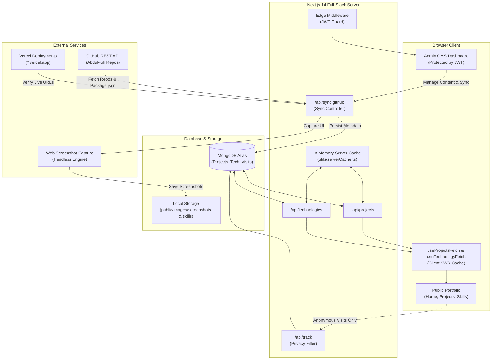

# 🚀 Modern Developer Portfolio & Project Showcase Engine

A high-performance, full-stack developer portfolio and content management system built with **Next.js 14 (App Router)**, **TypeScript**, **Tailwind CSS**, and **MongoDB**. Designed to showcase advanced frontend craftsmanship, real-time GitHub/Vercel synchronization, authentic live website screenshots, and sub-millisecond client-side caching.

Developed by **Abdullah Odulate** ([@Abdul-luh](https://github.com/Abdul-luh)) • [Live Demo](https://full-stack-portfolio-abdullah-odula.vercel.app)

---

## 🌟 Key Highlights & Engineering Features

### 1. 🔄 Automated GitHub & Vercel Sync Engine
- **Direct GitHub REST API Integration**: Dynamically pulls public repositories from [@Abdul-luh](https://github.com/Abdul-luh) with smart pagination and sorting.
- **Vercel & Live Deployment Detection**: Automatically scans repository homepages, descriptions, and commit metadata to detect hosted Vercel apps, GitHub Pages, and custom domains.
- **Deep Technology Extraction**: Parses `package.json` (`dependencies` and `devDependencies`) across repositories to identify frameworks, state management libraries, styling tools, and utilities (e.g. Next.js, React, Tailwind CSS, TypeScript, GSAP, Recharts, Zustand, Framer Motion, Radix UI, Prisma).
- **Intelligent Readme Extraction**: Automatically parses project `README.md` files to extract descriptive overviews, stripping markdown formatting while preserving technical highlights.

### 2. 📸 Authentic Web Page Screenshots Pipeline
- **Live Preview Thumbnails**: Replaces generic static placeholders and generic repository cards with actual, high-resolution screenshots of the deployed web applications.
- **Local Storage & Edge Caching**: Screenshots for live deployments (such as *Kilowash*, *Best Eats*, *NovaCart*, *Digital Agency*, *Data Finance*, *SickleSense*, and *Soles by Dunni*) are cached locally in `public/images/screenshots/` for instant `0ms` delivery without third-party rate limits.
- **Multi-Tier Fallback Hierarchy**:
  1. Authentic live web page screenshot (`/images/screenshots/<repo>.png`).
  2. High-resolution GitHub OpenGraph card (`https://opengraph.githubassets.com/1/Abdul-luh/<repo>`).
  3. Dynamic, procedural SVG/gradient banner generated deterministically from the project title hash.

### 3. ⚡ Zero-Flicker Multi-Tier Caching Architecture
- **Client-Side SWR In-Memory Cache**: Custom React hooks (`useProjectsFetch` and `useTechnologyFetch`) maintain an in-memory cache across client route transitions. Navigating between Home, `/projects-page`, and Admin views renders instantly (`loading: false`) with zero skeleton flickering.
- **Server Cache & HTTP Headers**: API routes (`/api/projects`, `/api/technologies`) utilize an in-memory server cache with `Cache-Control: public, s-maxage=60, stale-while-revalidate=300` headers.
- **Reactive Cache Invalidation**: Server and client caches automatically invalidate upon any project mutation, status toggle, or manual GitHub sync.

### 4. 🎨 Dynamic Skills & Tech Stack Showcase
- **Curated & Official Vector Logos**: Every recognized skill features its official, high-fidelity vector SVG or brand logo (including **GSAP**, **Recharts**, **Zustand**, **Framer Motion**, **React Router**, **Radix UI**, **Lucide Icons**, **Axios**, **Zod**, **Prisma**, **Redux Toolkit**, etc.).
- **Live Project Counter**: Displays how many featured projects actively utilize each technology.
- **Deep Filter Routing**: Clicking any technology badge routes to `/projects-page/[skill]`, instantly filtering all corresponding repositories.

### 5. 🛡️ Protected Admin CMS & Privacy-Focused Analytics
- **Secure Authentication**: Protected with **JWT (JSON Web Tokens)** stored in HTTP-only cookies, verified via Next.js Edge Middleware and **Bcrypt** password hashing.
- **Responsive Admin Dashboard**: Centralized, responsive form controls for managing projects, skills, certificates, and credentials.
- **Handwritten Typography**: Styled exclusively in the Admin portal using the Google Font *"Shadows Into Light"*.
- **Privacy-First Visit Tracking**:
  - Automatically ignores and excludes local development (`localhost`, `127.0.0.1`), developer Linux IP subnets (`105.113.*`, `10.*`), and authenticated admin sessions from website analytics.
  - Interactive admin analytics dashboard with date filtering, individual IP deletion, and one-click developer IP purging.

---

## 🛠️ Skills & Techniques Demonstrated

| Category | Skills & Techniques |
| :--- | :--- |
| **Frontend Architecture** | Next.js 14 App Router, React 18, React Server Components (RSC) & Client Components, Custom Hooks, SWR Pattern |
| **Styling & Design** | Tailwind CSS 3, Responsive Fluid Layouts, CSS Custom Variables, Dark/Light Mode Theme Transitions, Micro-interactions |
| **Type Safety & Quality** | 100% Strict TypeScript 5, Interface Segregation, Next.js ESLint Clean Standard (`0 warnings, 0 errors`) |
| **Backend & APIs** | Next.js Route Handlers (`GET`, `POST`, `PUT`, `PATCH`, `DELETE`), RESTful Architecture, Multipart Form Data Processing |
| **Database & ODM** | MongoDB Atlas, Mongoose 7 Schemas, Lean Queries, Indexing & Aggregation |
| **Authentication & Security** | JWT Signing & Verification, Bcrypt Salt Hashing, Secure HTTP-only Cookies, Edge Middleware Interception |
| **Performance Optimization** | Next/Image Optimization, Local Vector Asset Delivery, Stale-While-Revalidate Caching, Bundle Minimization |

---

## 🏛️ System Architecture



---

## 📁 Project Structure

```
my_portfolio/
├── app/
│   ├── admin/                    # Protected Admin CMS
│   │   ├── home/                 # Dashboard overview & analytics
│   │   │   └── view/             # View and manage projects & skills
│   │   └── login/                # Secure admin authentication
│   ├── api/
│   │   ├── auth/                 # Admin login, logout, verification
│   │   ├── projects/             # CRUD endpoints with server caching
│   │   ├── sync/github/          # GitHub & Vercel sync controller
│   │   ├── technologies/         # Dynamic skill aggregation API
│   │   └── track/                # Privacy-filtered analytics API
│   ├── components/
│   │   ├── adminComponents/      # Forms, tables, toast notifications
│   │   ├── Navbar.tsx            # Navigation & tracking controller
│   │   ├── Hero.tsx              # Interactive Hero with hidden admin gateway
│   │   ├── ProjectItem.tsx       # Project card with multi-tier fallbacks
│   │   ├── Projects.tsx          # Featured projects showcase
│   │   ├── Skills.tsx            # Interactive tech stack section
│   │   └── SkillsCard.tsx        # Vector skill card with deep linking
│   ├── hooks/
│   │   ├── useProjectsFetch.ts   # SWR in-memory projects hook
│   │   └── useTechnologyFetch.ts # SWR in-memory skills hook
│   ├── projects-page/            # All projects & skill filter pages
│   ├── layout.tsx                # Root layout & font configuration
│   └── page.tsx                  # Portfolio home page
├── model/                        # Mongoose data schemas (Project, Tech, Visit, User)
├── public/
│   └── images/
│       ├── screenshots/          # High-resolution web page screenshots
│       └── skills/               # Dedicated official skill vector logos
├── scripts/
│   └── cacheScreenshots.js       # Headless screenshot pre-caching utility
├── utils/
│   ├── githubSync.ts             # GitHub REST API sync engine
│   ├── serverCache.ts            # High-performance server memory cache
│   ├── techIcons.ts              # Tech stack icon mappings & parser
│   └── interfaces/               # Shared TypeScript interfaces
├── middleware.ts                 # Route protection for admin pages
├── next.config.js                # Remote patterns & webpack configuration
├── tailwind.config.js            # Tailwind theme & custom fonts
└── tsconfig.json                 # TypeScript compiler configuration
```

---

## 🚦 Getting Started

### Prerequisites
- **Node.js** v18.17+ or v20+
- **npm**, **yarn**, or **pnpm**
- **MongoDB Atlas** database connection string

### Installation

1. **Clone the repository:**
   ```bash
   git clone https://github.com/Abdul-luh/Full-stack_portfolio_Abdullah_Odulate.git
   cd Full-stack_portfolio_Abdullah_Odulate
   ```

2. **Install dependencies:**
   ```bash
   npm install
   ```

3. **Configure environment variables:**
   Create a `.env` file in the root directory:
   ```env
   # Database
   MONGO_URI=mongodb+srv://<username>:<password>@cluster0.mongodb.net/portfolio?retryWrites=true&w=majority

   # Admin Security
   TOKEN_SECRET=your_super_secret_jwt_key_here
   ADMIN_EMAIL=abdulluhodulate@gmail.com
   ADMIN_PASSWORD=your_secure_hashed_password

   # GitHub Sync (Optional token for higher rate limits)
   GITHUB_USERNAME=Abdul-luh
   GITHUB_TOKEN=ghp_your_personal_access_token
   ```

4. **Run the development server:**
   ```bash
   npm run dev
   ```
   Open [http://localhost:3000](http://localhost:3000) in your browser.

5. **Trigger initial project & screenshot sync:**
   - Log into the Admin dashboard at `/admin/login`.
   - Click the **"Sync with GitHub"** button on `/admin/home` to automatically populate all projects, screenshots, and technologies.

---

## 🧪 Testing & Code Quality

Run static analysis and linting:

```bash
# Type-check TypeScript codebase
npx tsc --noEmit

# Run Next.js ESLint linter
npm run lint

# Build production bundle
npm run build
```

---

## 👤 Author

**Abdullah Odulate**
- **GitHub**: [@Abdul-luh](https://github.com/Abdul-luh)
- **LinkedIn**: [Abdullah Odulate](https://linkedin.com/in/abdullah-odulate)
- **Email**: [abdulluhodulate@gmail.com](mailto:abdulluhodulate@gmail.com)

---

## 📄 License

This project is licensed under the [MIT License](LICENSE).
